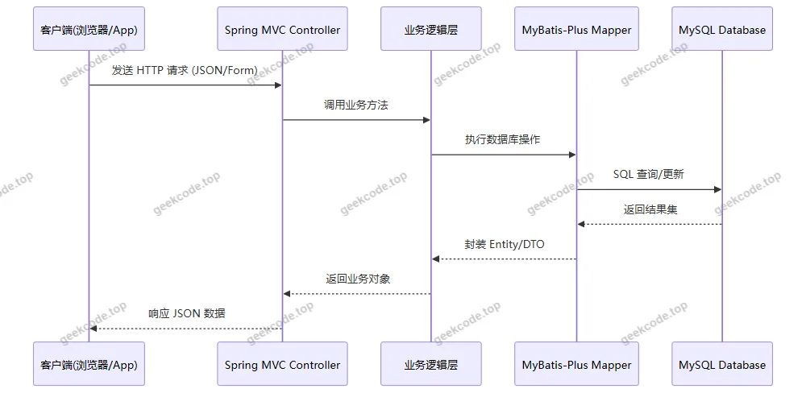
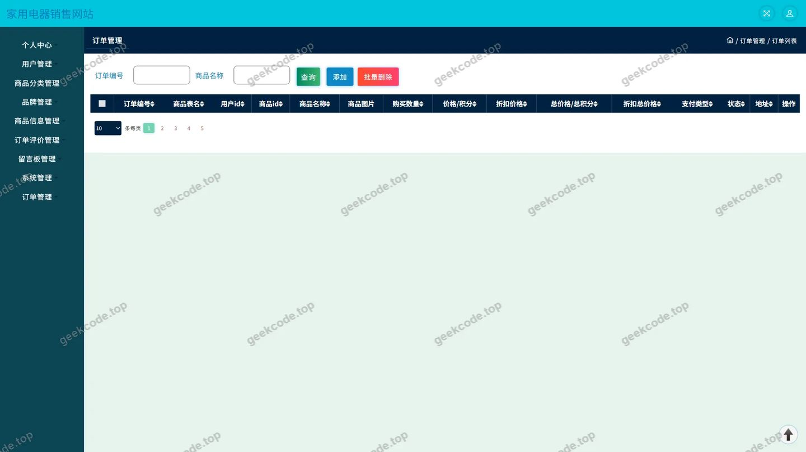
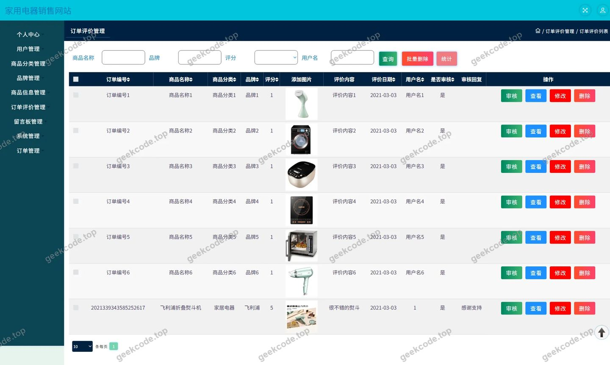
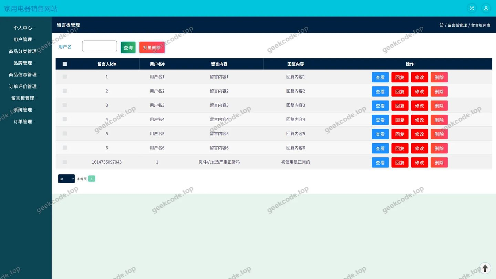
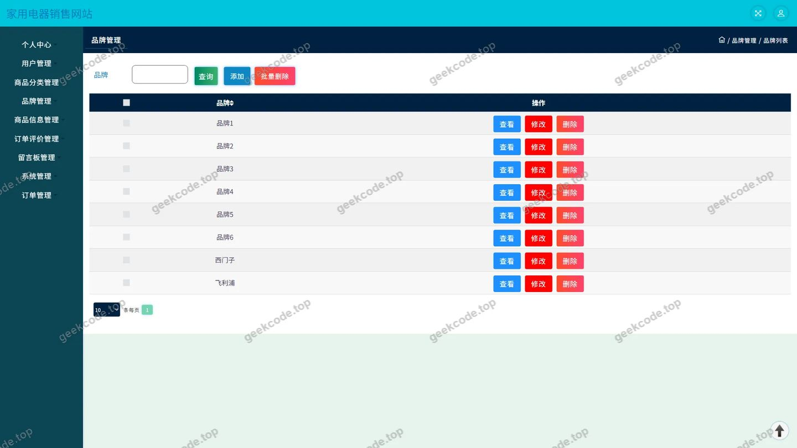
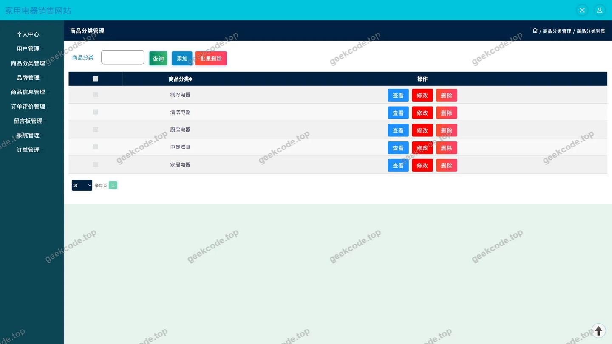
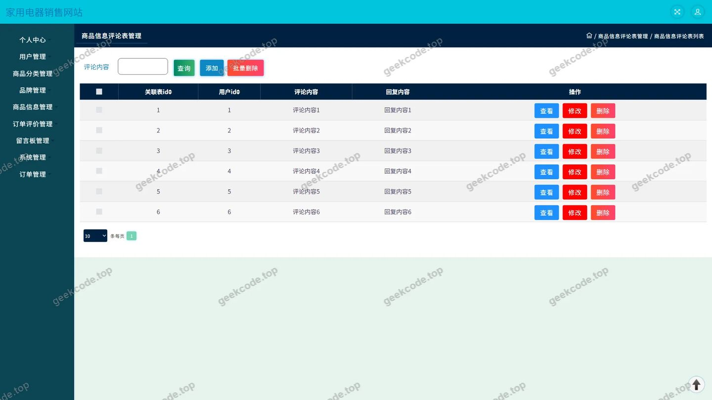
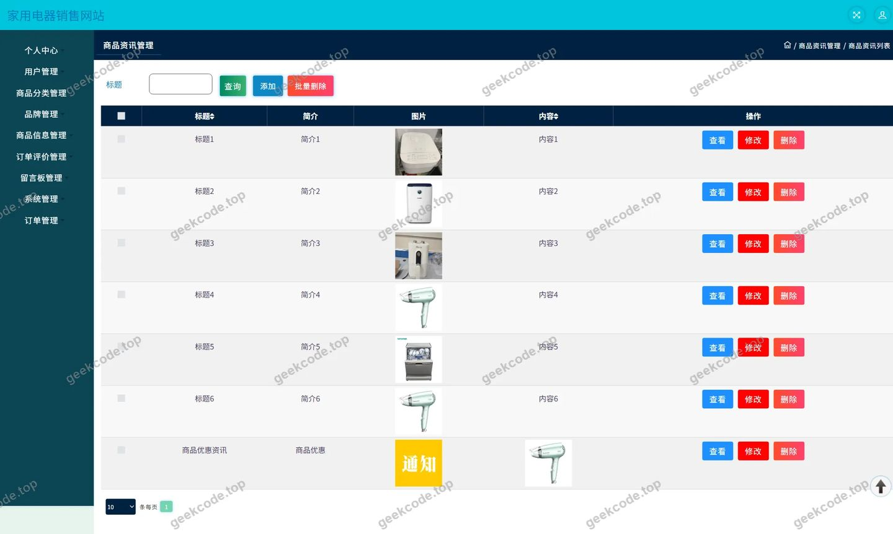
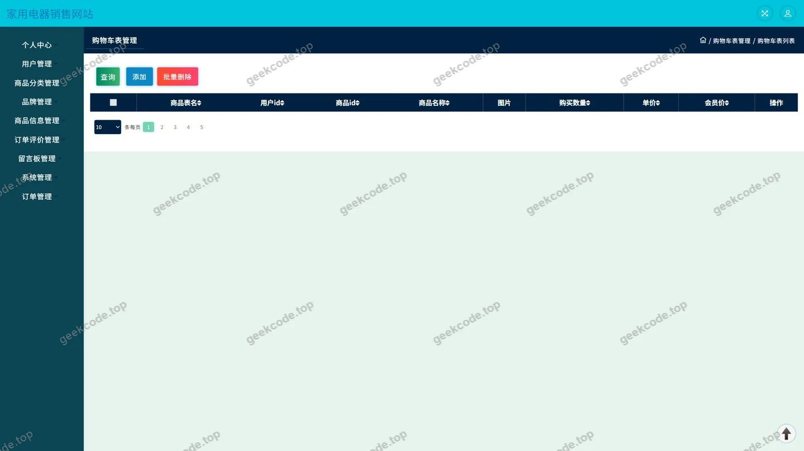

# 家用电器销售网站

> 🎓 **计算机毕业设计 · 家用电器销售网站**
>
> 本仓库只放**项目介绍 + 运行截图**（截图是站点带水印的原图，存在仓库 `images/` 里）。
>
> 👉 **完整可运行源码 / 数据库脚本 / 部署文档：[点我获取](https://geekcode.top/archives/%E5%AE%B6%E7%94%A8%E7%94%B5%E5%99%A8%E9%94%80%E5%94%AE%E7%BD%91%E7%AB%99?utm_source=github)**
>
> 💬 咨询微信：**ir9372**　|　🌐 更多项目：[极客代码 geekcode.top](https://geekcode.top/?utm_source=github)
>
> 📌 项目详情页：<https://geekcode.top/archives/%E5%AE%B6%E7%94%A8%E7%94%B5%E5%99%A8%E9%94%80%E5%94%AE%E7%BD%91%E7%AB%99?utm_source=github>

<table><td width="230" align="center"> <b>扫码加微信 ir9372</b></td><td valign="middle">📦 源码 = 项目介绍 + 全部运行截图 + 数据库 + 部署文档 👉 点上方任意截图，直接跳到 <b>极客代码 geekcode.top</b> 详情页</td></table>

---

<h1>家用电器销售网站</h1>
<h2>项目概述</h2>

本项目为“家用电器销售网站”后端服务系统，旨在构建一个基于 Java 技术栈的纯 API 接口平台。项目核心目标是提供稳定、高效的数据交互能力，支撑前端页面（如商品展示、订单处理、用户管理等）的业务逻辑运行。适用场景包括电商平台后端开发教学演示及小型家电零售系统的业务中台建设。

系统主要涵盖商品信息管理、品牌分类维护、订单全流程处理、用户地址与收藏管理、资讯发布以及留言反馈等功能模块。技术架构采用 Spring Boot 框架结合 MyBatis-Plus 进行持久层操作，并集成 Druid 连接池以优化数据库性能。虽然当前版本未包含可视化的后台管理界面和独立的前端路由配置，但其提供的 RESTful 接口完整覆盖了电商核心业务流程，具备高内聚低耦合的特点，便于后续前端技术的灵活对接与扩展。

<h2>技术架构</h2>
<h3>1. 总体架构设计</h3>

本项目采用前后端分离架构中的后端部分，定位为 <strong>Pure-API</strong> 服务模式。系统不直接渲染 HTML 页面，而是通过 HTTP/HTTPS 协议返回 JSON 格式数据，供客户端解析展示。

<ul>
<li><strong>表现层 (Controller)</strong>：由 <code>AddressController</code>, <code>CartController</code>, <code>OrdersController</code> 等组件构成，负责接收请求参数、调用业务逻辑并返回统一格式的响应结果。</li>
<li><strong>业务逻辑层 (Service)</strong>：隐含在 Controller 之下，处理具体的业务规则，如订单状态流转、库存扣减逻辑、评论审核等。</li>
<li><strong>持久层 (DAO/Mapper)</strong>：基于 <strong>MyBatis-Plus</strong> 实现，简化了单表 CRUD 操作，支持动态 SQL 生成，提高开发效率。</li>
<li><strong>数据库层</strong>：使用关系型数据库存储结构化数据，通过 <strong>Druid</strong> 连接池管理数据库连接，确保高并发下的稳定性与安全性。</li>
</ul>
<h3>2. 核心技术选型理由</h3>
<ul>
<li><strong>Spring Framework Suite</strong>: 选用 <code>spring-core</code>, <code>spring-context</code>, <code>spring-web</code>, <code>spring-webmvc</code> 等模块，利用其依赖注入（IoC）和面向切面编程（AOP）特性，实现代码解耦和事务管理（<code>spring-tx</code>）。</li>
<li><strong>MyBatis-Plus</strong>: 相比原生 MyBatis，MyBatis-Plus 提供了通用的 Mapper 接口和条件构造器，大幅减少了样板代码，适合快速构建标准电商实体（如商品、订单、用户）的数据访问层。</li>
<li><strong>Druid</strong>: 作为阿里巴巴开源的高性能 JDBC 连接池，它不仅具备强大的监控功能，还能有效防止 SQL 注入攻击，保障数据安全。</li>
</ul>
<h3>3. 数据交互流程</h3>

<h2>功能模块</h2>

根据源码控制器列表及截图功能点，系统划分为以下核心功能模块：

<h3>1. 用户中心模块</h3>

该模块主要负责用户的身份认证及个人数据管理。

<ul>
<li><strong>登录注册</strong>：对应截图“页面-登录”，提供用户身份验证接口，支持账号密码登录。</li>
<li><strong>个人信息管理</strong>：对应截图“页面-用户”，允许用户查看和修改基本资料。</li>
<li><strong>收货地址管理</strong>：由 <code>AddressController</code> 支持，实现地址的新增、删除、修改及设为默认地址功能。</li>
<li><strong>我的收藏</strong>：虽无单独 Controller 名称显示，但属于个人中心菜单项，通常复用通用逻辑或隐含在特定业务中，用于管理用户关注的商品。</li>
</ul>
<h3>2. 商品浏览与信息模块</h3>

提供商品数据的展示与分类检索能力。

<ul>
<li><strong>商品信息展示</strong>：核心业务入口，展示家电产品的详情、图片及规格。</li>
<li><strong>商品分类管理</strong>：由 <code>ShangpinfenleiController</code> 支持，维护商品的层级分类结构，便于用户筛选。</li>
<li><strong>品牌管理</strong>：由 <code>PinpaiController</code> 支持，维护家电品牌信息，支持按品牌检索商品。</li>
<li><strong>商品资讯</strong>：由 <code>NewsController</code> 支持，发布行业新闻、促销公告等内容，对应前台导航“商品资讯”。</li>
</ul>
<h3>3. 交易与购物车模块</h3>

处理用户的购买意向与实际订单生成。

<ul>
<li><strong>购物车管理</strong>：由 <code>CartController</code> 支持，实现加入购物车、修改数量、移除商品等操作。</li>
<li><strong>订单管理</strong>：由 <code>OrdersController</code> 支持，处理订单创建、支付状态更新、发货、收货等全生命周期状态流转。对应截图“页面-订单”。</li>
</ul>
<h3>4. 互动与评价模块</h3>

增强用户参与感，收集反馈数据。

<ul>
<li><strong>商品评论</strong>：由 <code>DiscussshangpinxinxiController</code> 支持，允许用户对已购买商品发表评价，对应截图“页面-商品信息评论”。</li>
<li><strong>订单评价</strong>：由 <code>DingdanpingjiaController</code> 支持，针对具体订单的服务体验进行评分和文字反馈，对应截图“页面-订单评价”。</li>
<li><strong>留言板/反馈</strong>：由 <code>MessagesController</code> 支持，提供非商品相关的通用咨询或投诉渠道，对应截图“页面-留言板”。</li>
</ul>
<h3>5. 系统基础配置模块</h3>
<ul>
<li><strong>文件上传</strong>：由 <code>FileController</code> 支持，处理商品图片、用户头像等静态资源的上传与存储。</li>
<li><strong>通用配置</strong>：由 <code>ConfigController</code> 和 <code>CommonController</code> 支持，管理系统字典、轮播图或其他全局配置参数。</li>
</ul>
<h2>用户角色与权限</h2>

由于该项目被定义为 <strong>pure-api</strong> 且明确标注“是否有后台: 否”，同时未提供具体的 RBAC（基于角色的访问控制）详细配置文档，根据现有信息无法确定是否存在独立的“管理员”角色及其专属权限体系。

但在典型的电商 API 设计中，通常存在以下两种隐式角色视角：

<ol>
<li><strong>普通用户 (Customer)</strong></li>
</ol>
<ul>
<li><strong>权限范围</strong>：仅能访问自身相关的数据。</li>
<li><strong>可执行操作</strong>：</li>
<li>浏览所有公开的商品、资讯、品牌和分类信息。</li>
<li>管理个人的收货地址、购物车和收藏夹。</li>
<li>创建订单，并对自己的订单进行评价或对商品发表评论。</li>
<li>提交留言反馈。</li>
<li><strong>限制</strong>：无权修改商品价格、库存、分类结构或审核他人评论。</li>
</ul>
<ol start="2">
<li><strong>超级管理员/运营人员 (Admin)</strong></li>
</ol>
<ul>
<li><strong>现状说明</strong>：项目中未包含后台管理路由 (<code>无后台路由</code>)，这意味着管理员的操作可能通过直接数据库维护、第三方管理工具或预留但未实现的内部接口完成。</li>
<li><strong>理论权限</strong>（基于 Controller 功能推断）：</li>
<li><strong>内容管理</strong>：通过 <code>NewsController</code> 发布资讯，通过 <code>PinpaiController</code> 和 <code>ShangpinfenleiController</code> 维护基础数据。</li>
<li><strong>订单干预</strong>：通过 <code>OrdersController</code> 查看和处理异常订单。</li>
<li><strong>审核机制</strong>：理论上需对 <code>DiscussshangpinxinxiController</code> 提交的敏感评论进行审核，但具体审核接口未在列表中明确区分。</li>
</ul>

<em>注：鉴于项目类型限制，上述管理员权限在当前交付的代码包中可能仅体现为数据写入接口的开放，缺乏显式的权限拦截逻辑描述。</em>

<h2>项目特色与创新点</h2>
<ol>
<li>
<strong>轻量级 API 优先架构</strong>
   项目摒弃了传统的单体应用视图层耦合，专注于后端逻辑的实现。这种 Pure-API 模式使得后端可以独立于前端技术栈（Vue, React, Flutter 等）进行开发和测试，极大地提升了系统的可移植性和前后端并行开发效率。

</li>
<li>
<strong>高度标准化的数据模型</strong>
   依托 MyBatis-Plus 的特性，系统构建了规范的商品、订单、用户三元核心模型。特别是将“商品评论”与“订单评价”分离为两个独立的控制器 (<code>DiscussshangpinxinxiController</code> vs <code>DingdanpingjiaController</code>)，体现了对用户反馈维度的精细化拆解——前者关注产品本身质量，后者关注物流服务体验，符合现代电商评价体系的最佳实践。

</li>
<li>
<strong>完善的辅助功能闭环</strong>
   除了核心的买卖流程，项目还集成了 <code>FileController</code> 解决多媒体资源存储问题，<code>ConfigController</code> 解决动态配置需求，以及 <code>MessagesController</code> 建立客服沟通通道。这些模块共同构成了一个具备自我迭代能力的生态系统雏形。

</li>
<li>
<strong>高性能连接池集成</strong>
   引入 Druid 作为数据库连接池，不仅提升了高并发场景下的响应速度，还为后续的 SQL 监控、防火墙防护提供了基础设施支持，体现了工程化思维在毕业设计中的应用。

</li>
</ol>
<h2>部署环境</h2>

为确保“家用电器销售网站”后端服务的正常运行，需准备以下软件环境：

<table>
<thead>
<tr>
<th align="left">组件</th>
<th align="left">版本要求/建议</th>
<th align="left">说明</th>
</tr>
</thead>
<tbody><tr>
<td align="left"><strong>JDK</strong></td>
<td align="left">Java 8+</td>
<td align="left">推荐 JDK 1.8 或更高版本，以兼容 Spring Boot 及相关依赖库。</td>
</tr>
<tr>
<td align="left"><strong>Maven</strong></td>
<td align="left">3.6+</td>
<td align="left">用于项目的依赖管理和打包构建。</td>
</tr>
<tr>
<td align="left"><strong>MySQL</strong></td>
<td align="left">5.7+ / 8.0+</td>
<td align="left">关系型数据库，用于存储用户、商品、订单等业务数据。需配置 UTF-8MB4 字符集以支持中文。</td>
</tr>
<tr>
<td align="left"><strong>IDE</strong></td>
<td align="left">IntelliJ IDEA / Eclipse</td>
<td align="left">开发调试工具，需安装 Lombok 插件（若代码中使用）。</td>
</tr>
<tr>
<td align="left"><strong>操作系统</strong></td>
<td align="left">Windows / Linux / macOS</td>
<td align="left">跨平台支持，Linux 环境下建议使用 CentOS 7+ 或 Ubuntu 20.04+ 进行生产部署。</td>
</tr>
</tbody></table>

<strong>启动步骤简述：</strong>

<ol>
<li>初始化 MySQL 数据库，导入对应的 SQL 脚本（如有）。</li>
<li>修改 <code>application.yml</code> 或 <code>application.properties</code> 中的数据库连接 URL、用户名和密码。</li>
<li>使用 Maven 命令 <code>mvn clean package</code> 编译项目。</li>
<li>执行 <code>java -jar target/your-project-name.jar</code> 启动服务。</li>
<li>通过 Postman 或浏览器访问配置的端口（默认为 8080）测试 API 接口连通性。</li>
</ol>
<h2>五、技术特性</h2>
<ul>
<li>使用 MyBatis-Plus 简化数据访问层开发</li>
</ul>
<h2>六、功能模块截图</h2>
<h3>后台管理端</h3>
<h4>页面-登录</h4>

<h4>页面-订单</h4>

<h4>页面-订单评价</h4>

<h4>页面-留言板</h4>

<h4>页面-品牌</h4>

<h4>页面-商品分类</h4>

<h4>页面-商品信息评论</h4>

<h4>页面-商品资讯</h4>

<h4>页面-用户</h4>

---

## 获取完整源码

| 项目 | 说明 |
| --- | --- |
| 项目名 | 家用电器销售网站 |
| 运行截图 | 本文 10 张（站点带水印原图，仓库 `images/` 目录） |
| 完整源码 | [https://geekcode.top/archives/%E5%AE%B6%E7%94%A8%E7%94%B5%E5%99%A8%E9%94%80%E5%94%AE%E7%BD%91%E7%AB%99?utm_source=github](https://geekcode.top/archives/%E5%AE%B6%E7%94%A8%E7%94%B5%E5%99%A8%E9%94%80%E5%94%AE%E7%BD%91%E7%AB%99?utm_source=github) |
| 咨询微信 | **ir9372**（备注：jingpin-yuanma） |
| 更多项目 | [极客代码 geekcode.top](https://geekcode.top/?utm_source=github) |

> 需要源码、部署、改配置、跑不起来等问题，加微信 ir9372 沟通，说明项目名即可。
